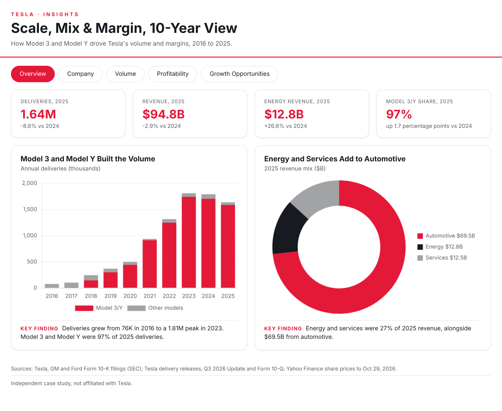
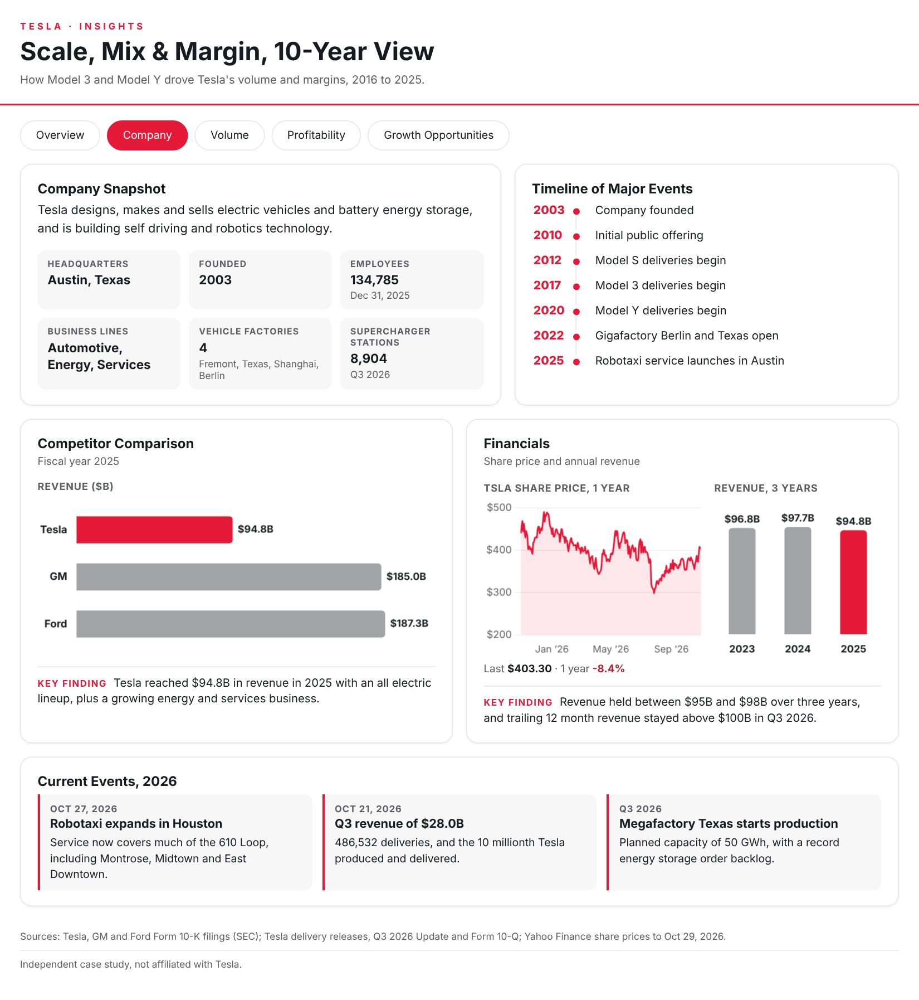
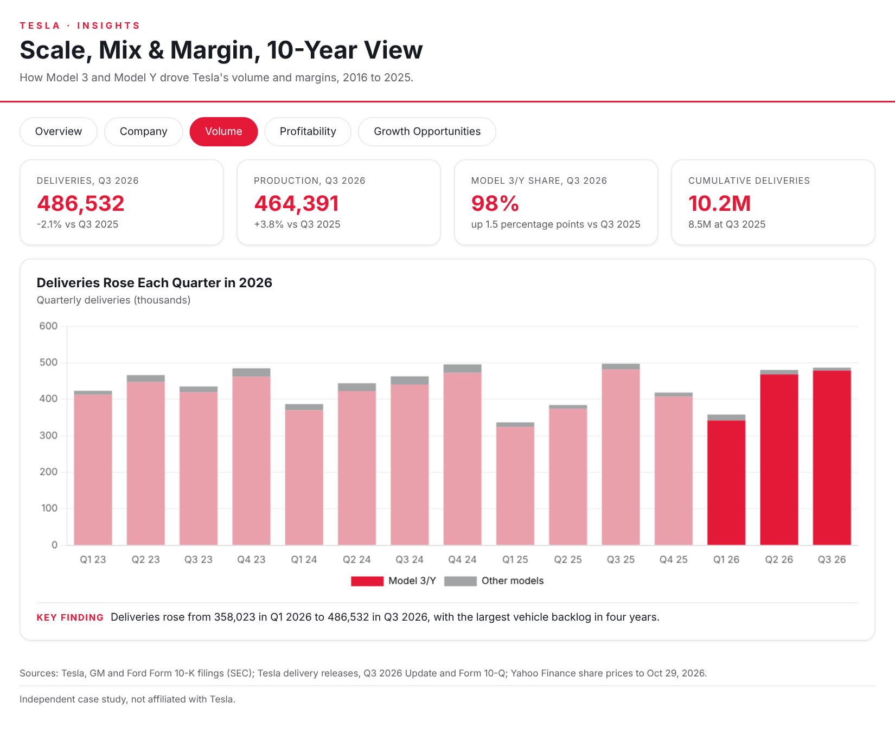
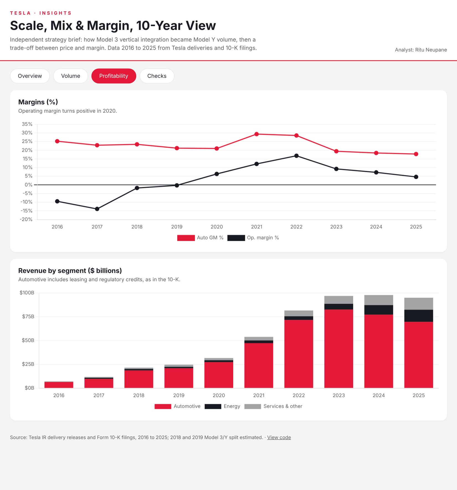
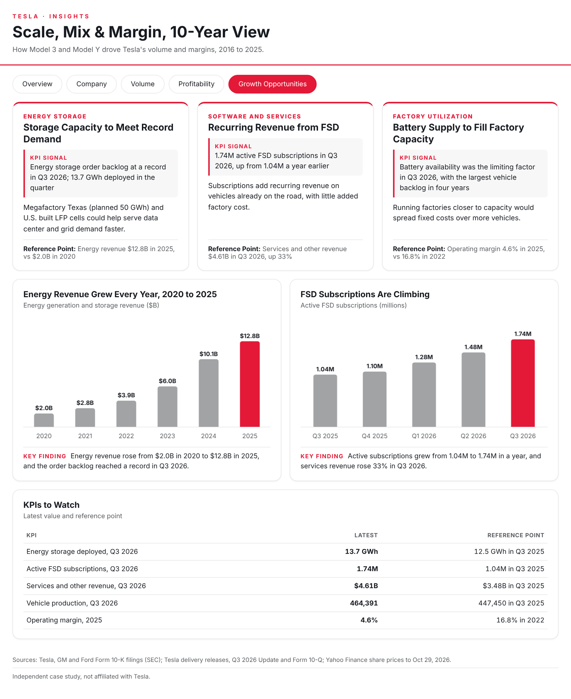

**Live dashboard:** https://rituneupane.github.io/tesla-insights-dashboard/

# Tesla: Scale, Mix and Margin, 10-Year View

How Model 3 and Model Y drove Tesla's volume and margins, 2016 to 2025, with a 2026 update. Built from Tesla's public delivery releases, 10-K filings, the Q3 2026 Update and the Q3 2026 Form 10-Q.

Independent case study, not affiliated with Tesla. Not a stock pick.

## Key findings

- Deliveries grew from about **76,000** in 2016 to a peak of **1.81 million** in 2023, and were **1.64 million** in 2025.
- Model 3 and Model Y were **97%** of 2025 deliveries.
- Deliveries rose each quarter in 2026, from **358,023** in Q1 to **486,532** in Q3.
- Energy revenue grew from about **$2.0 billion** (2020) to **$12.8 billion** (2025). Energy and services were **27%** of 2025 revenue, up from 9% in 2016.
- Gross margin was **19.6%** in Q3 2026, up 1.6 percentage points from Q3 2025.

## Dashboard tabs

| Tab | What it shows |
|---|---|
| Overview | 2025 KPIs vs 2024, annual deliveries by model, 2025 revenue mix |
| Company | Snapshot, timeline of major events, peer revenue view (GM, Ford), 1 year share price, 3 year revenue, 2026 current events |
| Volume | Q3 2026 KPIs vs Q3 2025, quarterly deliveries 2023 to Q3 2026 |
| Profitability | Margin KPIs, automotive gross margin and operating margin, revenue by segment |
| Growth Opportunities | Independent analyst observations (KPI signal, observation, reference point) on energy storage, FSD subscriptions and factory utilization |

Growth Opportunities are observations based on reported KPIs only. They are not company goals, carry no dollar estimates and include no pricing ideas.

**Overview**



**Company**



**Volume**



**Profitability**



**Growth Opportunities**



## Data

- The 2018 and 2019 Model 3/Y split is estimated. Tesla reports 3/Y as one group from 2020.
- Units: deliveries in thousands of vehicles, revenue in $ billions, margins in %.
- Full source list: [`data/SOURCES.md`](data/SOURCES.md).

## Files

```
data/tesla_annual.csv      annual series, 2016 to 2025
data/tesla_quarterly.csv   quarterly deliveries, 2023 Q1 to 2026 Q3
data/SOURCES.md            where the numbers came from
analysis/build.py          tie-out tests, writes docs/data.js
analysis/notes.md          takeaways
docs/                      live dashboard (index.html, data.js, company.js)
screenshots/               one image per tab
```

Rebuild the data file with `python analysis/build.py`.
